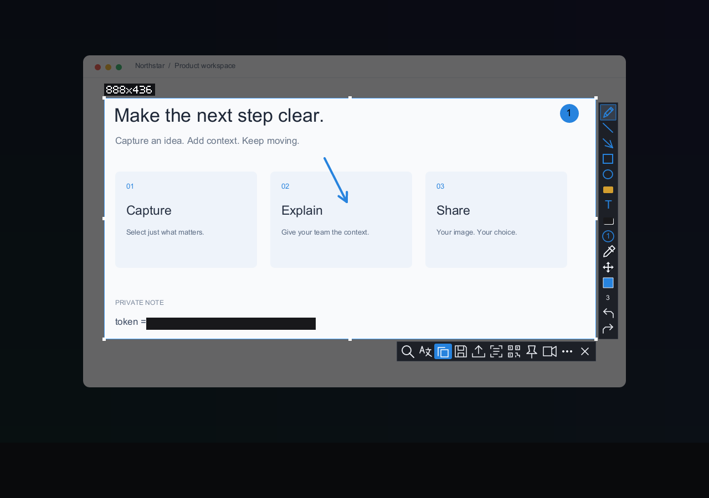
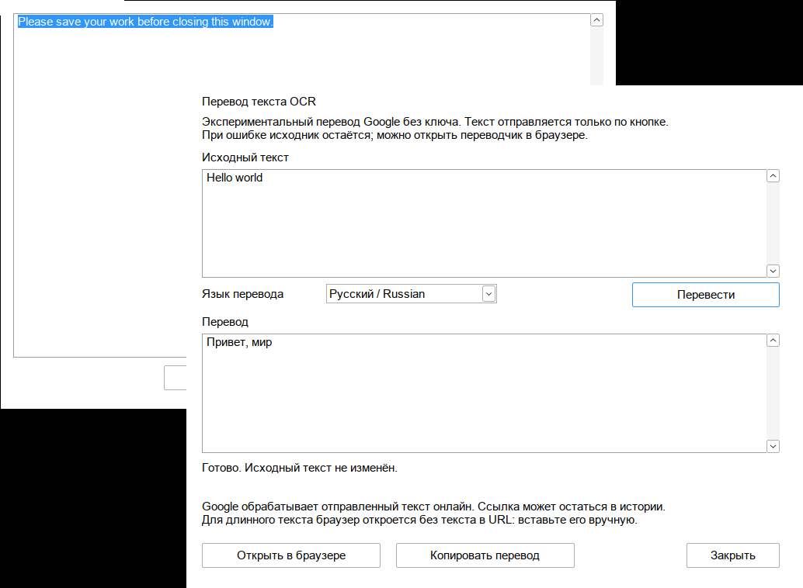
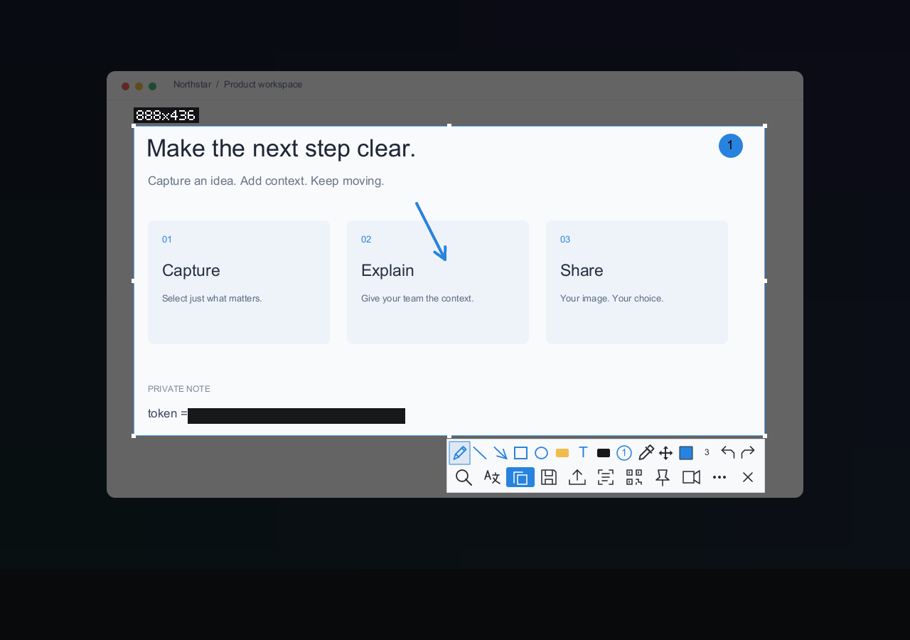
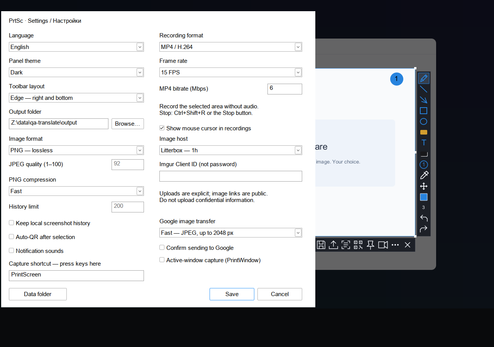

# PrtSc

**Capture. Explain. Share.** A small, native screenshot tool written in Rust.

[Download for Windows x64](https://github.com/qwkejkqwje1/PrtSc/releases/latest) · [English](#english) · [Русский](#русский) · [简体中文](#简体中文)



## English

Press PrintScreen, select what matters, and make your point. Draw an arrow, add a note, highlight a line or cover a private detail. Copy the result or save it without leaving the editor.

- Pen, shapes, text, numbered steps and opaque redaction. Undo/redo and a color remembered for each tool.
- Resize the selection by its edges. Choose an edge or compact toolbar, light or dark theme, and your own capture shortcut.
- Search the final image with Google Lens. Read text with Windows OCR or scan a QR code locally. QR links have separate open and copy actions.
- **Translate an image:** the button just after the magnifier copies the final selection and opens Google Translate Images. Press Ctrl+V or choose Paste an image there. No local OCR is needed. In the OCR result window, **Translate** optionally returns a text translation inside PrtSc, without an API key; a browser fallback keeps your original text available.
- Pin a screenshot above other windows, or record a live area as GIF/MP4 with an optional mouse cursor. No audio; screenshot annotations are not part of the video.

One portable EXE for Windows 10/11 x64. No Electron, .NET, WebView or external FFmpeg. The app interface is available in English and Russian.

**Your choice, not a background upload.** OCR and QR decoding run on your device. Google search sends the selected image only when requested. Translation sends text only after confirmation; text links may appear in browser history. “Copy and open” keeps text out of the URL, not out of Google's processing after you paste it. Clipboard history may also retain copied text. Screenshot history is off by default.

**Quick keys:** Enter / Ctrl+C copy · Ctrl+S save · Ctrl+G Google · Ctrl+T OCR · Ctrl+Shift+T image translation · Ctrl+Q QR · Ctrl+Shift+R record/stop.

## Русский

Нажмите PrintScreen, выделите нужное и покажите, что имеете в виду. Стрелка, короткая подпись, маркер или закрашенный личный фрагмент — затем копирование или сохранение, прямо из редактора.

- Карандаш, фигуры, текст, номера шагов и непрозрачное скрытие данных. Есть отмена и повтор; каждый инструмент помнит свой цвет.
- Рамка растягивается за края. Можно выбрать компактную панель или панель по краям, светлую или тёмную тему и своё сочетание для снимка.
- Поиск итоговой картинки в Google Lens, локальное распознавание текста и QR. У QR-ссылки отдельные действия: открыть или скопировать.
- **Перевод картинки:** кнопка сразу после лупы копирует итоговое выделение и открывает Google Translate → «Изображения». Нажмите там Ctrl+V или «Вставить изображение». Локальный OCR не нужен. В окне OCR кнопка **«Перевести»** отдельно получает перевод текста прямо в PrtSc, без ключа; при ошибке есть браузерный вариант без потери исходника.
- Закрепление снимка поверх окон и запись живой области в GIF/MP4 с курсором или без него. Без звука; пометки редактора в видео не попадают.

Один переносимый EXE для Windows 10/11 x64. Без Electron, .NET, WebView и внешнего FFmpeg. Интерфейс — на русском и английском.

**Ничего не загружается в фоне.** OCR и QR работают на устройстве. Поиск отправляет выделенную картинку только по вашей команде. Перевод — текст после подтверждения; текст из ссылки может остаться в истории браузера. «Скопировать и открыть» убирает текст из URL, но после вставки его всё равно обрабатывает Google. Учтите и историю буфера обмена. История снимков по умолчанию отключена.

**Клавиши:** Enter / Ctrl+C копировать · Ctrl+S сохранить · Ctrl+G Google · Ctrl+T OCR · Ctrl+Shift+T перевод картинки · Ctrl+Q QR · Ctrl+Shift+R запись/стоп.

## 简体中文

按下 PrintScreen，框选需要的内容，再把重点说清楚。画箭头、写批注、标亮一行文字，或用不透明色块遮住私人信息，然后直接复制或保存。

- 提供画笔、形状、文字、步骤编号和不透明遮盖，支持撤销与重做。每种绘图工具会记住自己的颜色。
- 拖动边框即可调整选区。可选边缘式或紧凑式工具栏、浅色或深色主题，也能录入自己的截图快捷键。
- 用 Google Lens 搜索编辑后的图片，在本机识别文字和二维码。二维码链接的打开与复制是两个独立操作。
- **图片翻译：**放大镜后面的按钮会复制编辑后的选区并打开 Google 翻译的图片页面。在网页中按 Ctrl+V 或点击粘贴图片，无需本机 OCR。文字识别窗口另有 **翻译** 按钮，可在 PrtSc 内获取文字翻译，无需 API 密钥；服务不可用时仍保留原文，并可打开浏览器继续。
- 将截图置顶，或把实时屏幕区域录制为 GIF/MP4，可选择是否显示鼠标指针。不录音；截图批注不会加入视频。

适用于 Windows 10/11 x64，单个便携 EXE，无需 Electron、.NET、WebView 或外部 FFmpeg。应用界面目前支持英语和俄语。

**是否上传，由你决定。** OCR 和二维码识别在本机完成。只有点击搜索，选区图片才会发送给 Google。翻译也需要确认；含文字的网址可能留在浏览器历史记录中。“复制并打开”避免把文字放入网址，但粘贴后仍会由 Google 在线处理。剪贴板历史也可能保留文字。截图历史默认关闭。

**快捷键：**Enter / Ctrl+C 复制 · Ctrl+S 保存 · Ctrl+G Google 搜索 · Ctrl+T 文字识别 · Ctrl+Shift+T 图片翻译 · Ctrl+Q 二维码 · Ctrl+Shift+R 开始/停止录制。

## In use / В работе / 功能预览



*A real Google response to sample text, shown in the native app. OCR input is a fixture, not a claim of recognition accuracy. / Настоящий ответ Google на тестовый текст в окне программы; ввод OCR — тестовый пример. / 原生窗口中的真实 Google 翻译结果，识别输入使用示例文字。*





*Editor examples use a synthetic demonstration screen. / В редакторе показана демонстрационная сцена. / 编辑器截图使用演示画面。*

## Before you run / Перед запуском / 使用前

- Exit the old copy from the tray before replacing the EXE. The build is unsigned; Windows may show a reputation warning.
- OCR text translation needs installed Windows OCR languages; image translation does not. Image transfer requires a manual paste in the browser — it is not an automatic upload. In-app text translation uses an undocumented Google endpoint: availability, format and limits may change. Internet access is required.
- GIF was verified here; MP4 uses Windows Media Foundation and still needs real-Windows acceptance testing. Windows N may need Media Feature Pack. Wine is not a substitute for testing on Windows hardware.
- Blur/pixelation are not secure redaction. Use an opaque block for secrets. Upload-host links are public; historical Catbox/Litterbox HTTP 412 errors remain unresolved.
- Settings: `%LOCALAPPDATA%\PrtSc`. Default screenshots: `Pictures\PrtSc`. Source and limitations: [QA](docs/QA.md), [status](docs/STATUS.md), [changes](docs/CHANGELOG.md).

## Build

Rust stable + Windows x64 GNU/MSVC toolchain. GNU builds also need MinGW-w64/windres.

```sh
cargo build --locked --release
cargo test --locked --all-targets -- --test-threads=1
# Cross-compile from Linux:
cargo build --locked --release --target x86_64-pc-windows-gnu
```

[MIT license](LICENSE) · [Third-party notices](THIRD-PARTY-NOTICES.txt)
